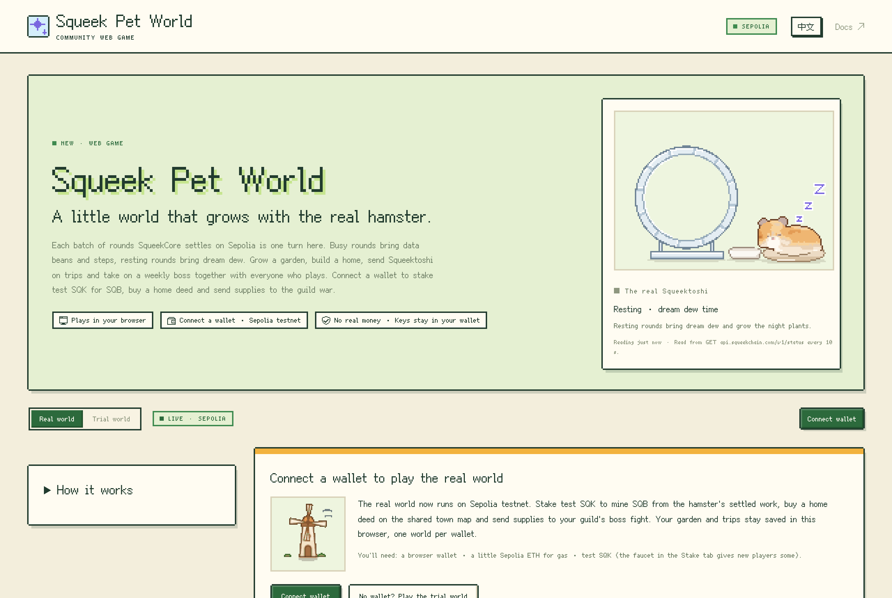
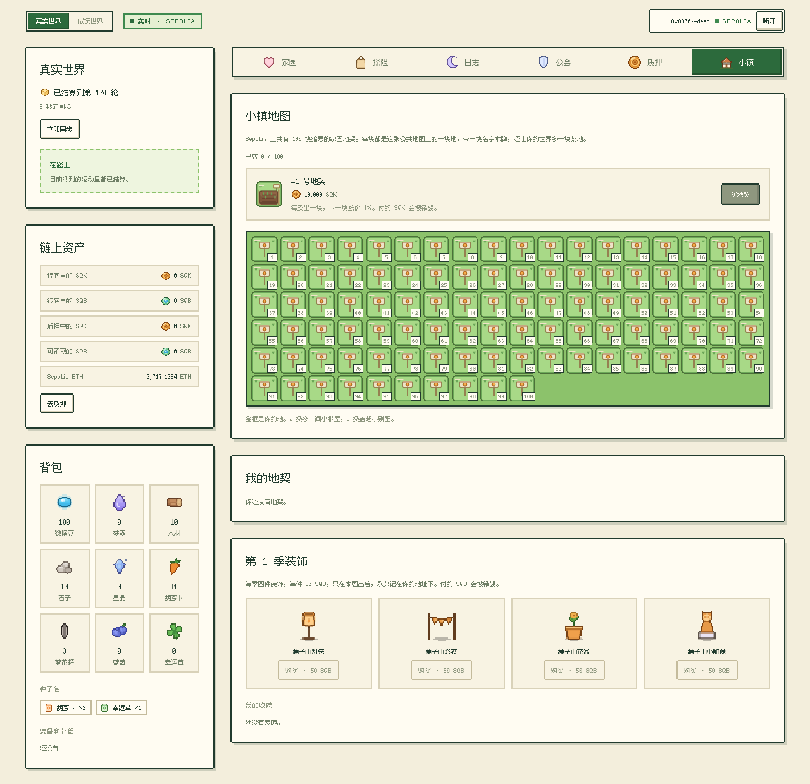

# Squeek Pet World

[中文](README.zh-CN.md)

A little web game that grows with **Squeektoshi**, the real hamster on SqueekChain (Ethereum Sepolia testnet). Play it at **[world.squeekpulse.xyz](https://world.squeekpulse.xyz)**, in English or Chinese, on a computer or a phone.

Each batch of rounds SqueekCore settles on Sepolia, about every ten minutes, is one turn here, so no amount of clicking can speed it up. Busy rounds bring data beans and steps, resting rounds bring dream dew. Grow a garden, build a home, send Squeektoshi on trips and take on a weekly boss together with everyone who plays. With a Sepolia wallet you can also stake test SQK to earn SQB, buy a home deed on the shared town map and send supplies to the guild war.

This is an independent community project, not an official SqueekChain product. It runs only on the Sepolia testnet: SQK and SQB here have no real value. The [whitepaper](https://world.squeekpulse.xyz/whitepaper/en/) ([中文](https://world.squeekpulse.xyz/whitepaper/), which prevails) explains the design, the turns, the two tokens, the contracts and the risks.



## How it plays

| Tab | What you do |
| --- | --- |
| Home | Plant crops in the garden beds and harvest them, build and upgrade eight buildings, unlock new areas. |
| Adventure | Pick one of five routes, up to two pieces of gear, a snack or a charm. Settled work walks the trip forward; choose a path at the fork and bring home what you found. |
| Log | What every settled round gave, with a link to its Sepolia transaction, and the world's diary. |
| Guild | Join one of four guilds for the season, pick a class, plan your move against the weekly boss, then open the season's chest. With a wallet, send SQB supplies to the boss or found a player guild with SQK. |
| Stake | Stake test SQK to earn **SQB**: every 10 work units the hamster settles become 1 SQB, paid over 24 hours to everyone staked, in proportion to their stake. A faucet gives new players some test SQK. |
| Town | Buy one of 100 numbered home deeds (an NFT, paid in SQK), name it, renovate it with SQB and place it in your world as an extra garden bed. Buy the season's decorations with SQB. |

- One turn is one settled SqueekCore batch (`system.settlement_completed` in `GET /v1/events?category=protocol`, after 12 confirmations). Every settled turn pays once, and the world on screen is always replayed from the settled turns and your choices, so an edited number in storage can't turn into progress.
- Data beans, crops and trips live in your browser; they are not tokens. Export and import your save as text. Nothing runs while no World tab is open; opening the page catches up on about the last two weeks.
- Everyone fights the same weekly boss. Each browser works out its HP from public data, with no game server: the hamster's settled work, community activity on SqueekChain (at most 30% of the HP) and the hamster's milestones (at most 20%).
- The **trial world** runs on made-up rounds so every rule can be tried in minutes. It has its own save and always says **TRIAL · SIMULATED**.
- On chain, every SQK and SQB spent is burned; there is no treasury, and SQB has no premine. Each turn of the game stays free and off-chain; only assets and the economy are on Sepolia.



## What's in this repository

```
src/           the game (TypeScript): rules as data, the turn engine, the settlement feed and ledger,
               saves, the shared boss, texts in both languages, art turned into pixel art, the tabs
src/world/chain/   the on-chain part: reads, the wallet, permits, transactions and their errors
site/          the website around the game: the page (top bar, live hamster, footer), styles,
               fonts and sprites, response headers (site/public/), its tests and its build
site/whitepaper/   the whitepaper's two sources (zh.md, which prevails, and en.md) and the
               generator that writes its pages into site/public/whitepaper/
contracts/     the SQB token, the minter, the World shop and the SQK faucet (Solidity, Hardhat),
               their tests, and the deploy page; see contracts/README.md
tests/         the game's tests (Vitest)
world.html     a bare page for working on the game (src/world-dev.ts)
```

The game and the contracts were moved here from [squeek-pet](https://github.com/zakehowell/squeek-pet) (commit `87d1944`) and the site from Squeek Pulse on 2026-11-07. Squeek Pet, the desktop hamster, stays in its own repository; only the pet is a desktop app, and the World is played in the browser.

## Developing

Node.js 20.19 or newer (the GitHub workflow uses 22).

```sh
npm ci
npm run dev        # http://127.0.0.1:1420/world.html: the game on a bare page (?mode=trial, ?tab=guild, ?lang=zh)
npm test           # the game's tests, then build the game and run the site's tests (no network needed)
npm run build      # check types, build the game, build the site into dist/
npm run preview    # build, then serve dist/ with Cloudflare's local Pages server, headers and 404 included
```

`npm run build:game` turns `src/world` into one script, `dist-game/squeek-world.js`, whose `mountWorld(element, { language, chain })` draws the game in the element's shadow root, so the page's styles and the game's never mix. `site/build.mjs` bundles it with the page (`site/src/world-page.js`), copies `site/public/`, the fonts and the sprites, and writes `dist/`. The script's first comment names the commit it was built from and stays at the end of the deployed `world.js`, so you can see which commit is live.

`chain` is the World config the deploy page prints: the contracts' addresses and a public Sepolia node. The site's copy is `site/src/world-chain.js`; set to `null`, the World is the read-only game.

The whitepaper is written in `site/whitepaper/zh.md` and `en.md`, which keep the same chapters, sections, tables and figures. After editing either, run `node site/whitepaper/render.mjs`: it writes the two static pages, `/whitepaper/` and `/whitepaper/en/`, into `site/public/whitepaper/`. Commit them with the sources; `site/tests/whitepaper.test.js` fails while they are out of date.

The contracts are a package of their own: `cd contracts && npm ci && npm test`. Playing the on-chain World on a local fork of Sepolia is described in [contracts/README.md](contracts/README.md).

## Deploying

The site is the Cloudflare Pages project `squeek-world`; world.squeekpulse.xyz is a CNAME to `squeek-world.pages.dev`.

- **From GitHub.** [`.github/workflows/deploy.yml`](.github/workflows/deploy.yml) tests every pull request and every push to `main`: the game, the site and the contracts. After a push to `main`, once everything passes, it builds the site and uploads `dist/` to production. It needs two repository secrets (Settings → Secrets and variables → Actions): `CLOUDFLARE_API_TOKEN`, an account API token with only the *Cloudflare Pages: Edit* permission, and `CLOUDFLARE_ACCOUNT_ID`. To deploy again without a new commit, run the workflow on `main` from the Actions tab.
- **By hand.** `npx wrangler@4.158.0 login`, then `npm run deploy` (tests, builds, uploads).

Cloudflare keeps every deployment, and any of them can be restored from the dashboard.

## Safety

- The page and its response headers allow scripts only from the site itself, let it connect only to api.squeekchain.com and one public Sepolia node, and forbid other sites from framing it.
- Nothing here handles private keys, signs anything by itself or sends a transaction on its own. Every transaction and signature is confirmed in the player's own wallet, found through EIP-6963; transactions are simulated first, and approvals use one-off signed permits where the wallet supports them. `site/tests/world-page.test.js` checks the built game asks the wallet for nothing else and reads no other host.
- No accounts, analytics or personal data. Saves stay in the browser, one world per wallet.

## SqueekChain project

This repository is the project `543908d3-0cc8-4811-967b-8efb5e928cfd` on SqueekChain. The line below is the ownership record SqueekChain rechecks every day; keep it public:

squeekchain-project: 543908d3-0cc8-4811-967b-8efb5e928cfd

## License

MIT ([LICENSE](LICENSE)). Fonts, the SqueekChain deployment record and the art: [THIRD_PARTY_NOTICES.md](THIRD_PARTY_NOTICES.md).
