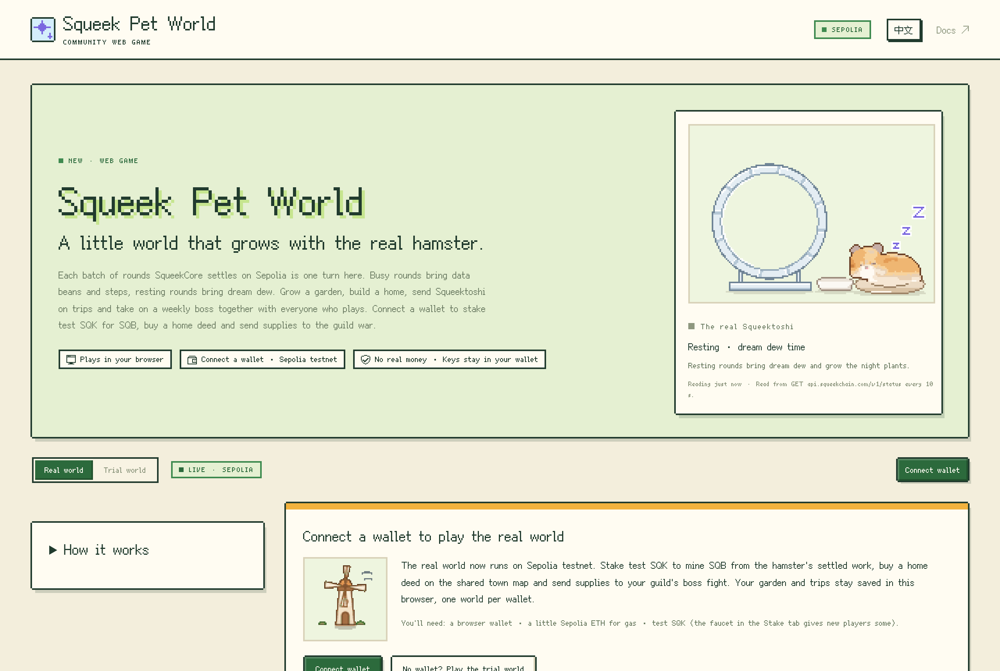
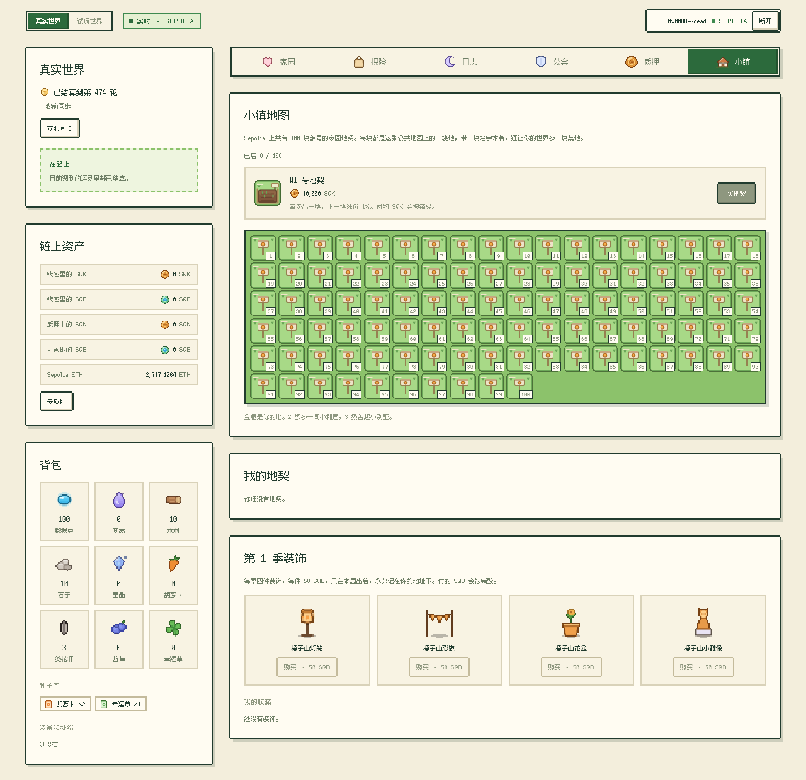

# Squeek Pet World

[English](README.md)

跟着真实仓鼠 **Squeektoshi** 一起长大的网页小游戏，数据来自 SqueekChain（以太坊 Sepolia 测试网）。在线玩：**[world.squeekpulse.xyz](https://world.squeekpulse.xyz)**，中英文都有，电脑和手机都能玩。

SqueekCore 在 Sepolia 上大约每十分钟结算一批，每结算一批，游戏就前进一个回合，点得再快也不会加速。跑步的回合带来数据豆和探险步数，休息的回合带来梦露。种菜、盖房子、派 Squeektoshi 去探险，再和所有玩家一起挑战每周的 Boss。连接 Sepolia 测试网钱包后，还可以质押测试网 SQK 挖 SQB、在公共小镇地图上买家园地契、给公会战送补给。

这是独立社区项目，不是 SqueekChain 官方产品。只在 Sepolia 测试网运行，这里的 SQK 和 SQB 没有真实价值。[白皮书](https://world.squeekpulse.xyz/whitepaper/)（[English](https://world.squeekpulse.xyz/whitepaper/en/)，以中文版为准）说明了游戏的设计、回合机制、双币经济、合约和风险。



## 怎么玩

| 标签页 | 玩法 |
| --- | --- |
| 家园 | 在菜地里种菜、收菜，建造和升级八种建筑，解锁新区域。 |
| 探险 | 选五条路线之一，最多带两件装备、一份零食或一个护符。已结算的运动量推着旅程前进，到岔路口选一条路，把找到的东西带回家。 |
| 日志 | 每个已结算回合带来了什么，附 Sepolia 交易链接，还有世界日记。 |
| 公会 | 每个赛季加入四个公会之一，选职业，计划怎么打本周 Boss，赛季结束开宝箱。连接钱包后，可以用 SQB 给 Boss 送补给，或花 SQK 创建玩家公会。 |
| 质押 | 质押测试网 SQK 挖 **SQB**：仓鼠每结算 10 个运动量单位产出 1 SQB，在 24 小时内按质押比例发给所有质押者。新玩家可以从水龙头领一些测试网 SQK。 |
| 小镇 | 买 100 块编号家园地契之一（NFT，用 SQK 付），给它起名、用 SQB 翻修，再放进自己的世界当一块额外的菜地。用 SQB 买本赛季的装饰。 |

- 一个回合就是 SqueekCore 结算完成的一批（`GET /v1/events?category=protocol` 里的 `system.settlement_completed`，等 12 个确认）。每个已结算回合只结算一次；屏幕上的世界永远由已结算回合加上你的选择重新推算出来，所以改本地存档里的数字变不成进度。
- 数据豆、作物和探险都存在你的浏览器里，不是代币。存档可以导出、导入成文本。没开 World 页面时什么都不会跑；打开页面会补算大约最近两周的回合。
- 所有人打同一个每周 Boss。每个浏览器都用公开数据自己算出 Boss 的血量，没有游戏服务器：仓鼠已结算的运动量、SqueekChain 上的社区活动（最多占血量 30%）和仓鼠的里程碑（最多 20%）。
- **试玩世界**用模拟回合，几分钟就能试遍所有规则。它有单独的存档，并始终标着 **试玩 · 模拟数据**。
- 链上花掉的每一个 SQK 和 SQB 都会被销毁，没有金库，SQB 也没有预挖。游戏的每个回合仍然免费、不上链；只有资产和经济在 Sepolia 上。



## 仓库里有什么

```
src/           游戏本体（TypeScript）：规则数据、回合引擎、结算记录和账本、存档、共享 Boss、
               中英文文案、转成像素画的美术、各个标签页
src/world/chain/   上链部分：读链、钱包、permit 签名、交易和错误提示
site/          包住游戏的网站：页面（顶栏、实时仓鼠、页脚）、样式、字体和小图、
               响应头（site/public/）、网站自己的测试和构建
site/whitepaper/   白皮书的两份原稿（zh.md 为准，en.md）和生成器，生成的网页在
               site/public/whitepaper/
contracts/     SQB 代币、铸币合约、World 商店和 SQK 水龙头（Solidity、Hardhat）、
               合约测试和部署页，见 contracts/README.md
tests/         游戏的测试（Vitest）
world.html     单独调试游戏用的空白页面（src/world-dev.ts）
```

游戏和合约在 2026-11-07 从 [squeek-pet](https://github.com/zakehowell/squeek-pet)（提交 `87d1944`）搬过来，网站从 Squeek Pulse 搬过来。桌面宠物 Squeek Pet 留在自己的仓库：只有宠物是桌面应用，World 在浏览器里玩。

## 开发

需要 Node.js 20.19 或更新版本（GitHub 工作流用 22）。

```sh
npm ci
npm run dev        # http://127.0.0.1:1420/world.html：在空白页面上运行游戏（?mode=trial、?tab=guild、?lang=zh）
npm test           # 先跑游戏测试，再构建游戏、跑网站测试（不联网）
npm run build      # 检查类型、构建游戏、把网站构建到 dist/
npm run preview    # 构建后用 Cloudflare 的本地 Pages 服务器预览 dist/（含响应头和 404）
```

`npm run build:game` 把 `src/world` 打包成一个脚本 `dist-game/squeek-world.js`，它的 `mountWorld(element, { language, chain })` 在元素的 shadow root 里画出游戏，页面样式和游戏样式互不干扰。`site/build.mjs` 把它和页面（`site/src/world-page.js`）打包在一起，复制 `site/public/`、字体和小图，输出到 `dist/`。脚本第一行注释写着它是从哪个提交构建的，部署后的 `world.js` 末尾也保留这一行，可以直接看出线上是哪个版本。

`chain` 是部署页输出的 World 配置：合约地址和一个公共 Sepolia 节点。网站用的那份在 `site/src/world-chain.js`；设成 `null` 时，World 就是只读游戏。

白皮书写在 `site/whitepaper/zh.md` 和 `en.md` 里，两份的章节、小节、表格和图保持一致。改了任何一份，都要运行 `node site/whitepaper/render.mjs`：它把两张静态网页 `/whitepaper/` 和 `/whitepaper/en/` 写进 `site/public/whitepaper/`。把它们和原稿一起提交；网页没更新时，`site/tests/whitepaper.test.js` 会失败。

合约是单独的一个包：`cd contracts && npm ci && npm test`。在本地 Sepolia 分叉上玩链上 World 的方法见 [contracts/README.md](contracts/README.md)。

## 部署

网站是 Cloudflare Pages 项目 `squeek-world`，world.squeekpulse.xyz 用 CNAME 指向 `squeek-world.pages.dev`。

- **GitHub 自动部署**：[`.github/workflows/deploy.yml`](.github/workflows/deploy.yml) 会给每个 PR 和每次推送到 `main` 跑测试（游戏、网站、合约）。推送到 `main` 且全部通过后，构建网站并把 `dist/` 发布到正式环境。仓库需要两个 secret（Settings → Secrets and variables → Actions）：`CLOUDFLARE_API_TOKEN`（只给 *Cloudflare Pages: Edit* 权限的账户 API 令牌）和 `CLOUDFLARE_ACCOUNT_ID`。不提交新代码也想重新部署时，在 Actions 页面对 `main` 手动运行这个工作流。
- **手动部署**：先 `npx wrangler@4.158.0 login`，再 `npm run deploy`（先测试、再构建、再上传）。

Cloudflare 会保留每一次部署，可以在后台恢复到任意一次。

## 安全

- 页面和响应头只允许加载本站的脚本，只允许连接 api.squeekchain.com 和一个公共 Sepolia 节点，并禁止其他网站嵌套这个页面。
- 这里没有任何处理私钥、自行签名或自己发交易的代码。每笔交易和签名都要在玩家自己的钱包里确认（通过 EIP-6963 找到钱包）；交易会先模拟，钱包支持时授权用一次性的 permit 签名。`site/tests/world-page.test.js` 会检查构建出的游戏不向钱包要别的东西，也不读取别的网站。
- 没有账号、统计或个人数据。存档留在浏览器里，每个钱包一个世界。

## 许可

代码使用 MIT 许可（[LICENSE](LICENSE)）。字体、SqueekChain 部署记录和美术素材见 [THIRD_PARTY_NOTICES.md](THIRD_PARTY_NOTICES.md)。
